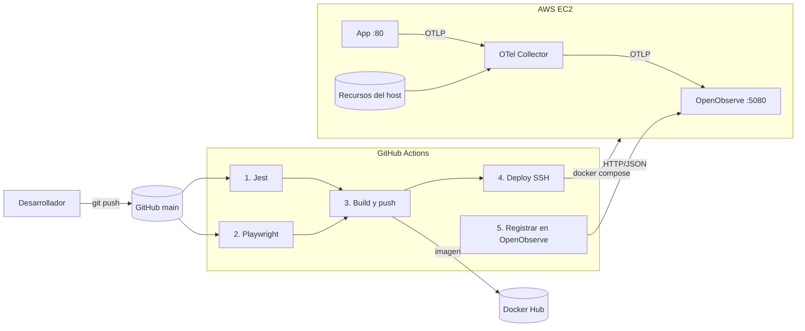

# Gestor de Tareas — CI/CD, pruebas automatizadas y observabilidad

Aplicación web de tareas (**frontend + API REST** con Node.js, Express y SQLite) con:

- **Pruebas**: 114 pruebas de backend con **Jest + Supertest** (cobertura ≥ 70 %) y 42 pruebas de extremo a extremo con **Playwright** (interfaz y API).
- **CI/CD** en **GitHub Actions**: si las pruebas pasan, publica la imagen en Docker Hub y despliega por SSH en **AWS EC2**. Si una prueba falla, no hay despliegue.
- **Observabilidad**: la app está instrumentada con **OpenTelemetry** (logs, métricas y trazas) y envía todo a **OpenObserve**, que corre en la misma EC2 junto con un **OpenTelemetry Collector** que mide CPU, RAM, red, disco y temperatura del servidor.
- Cada ejecución del pipeline (resultado de cada job, commit, rama, usuario) y cada despliegue se registran en OpenObserve (stream `cicd_pipeline`).

## Arquitectura



## Estructura

| Ruta | Contenido |
|---|---|
| `src/` | API Express, base SQLite, `telemetry.js` (SDK de OpenTelemetry) y `observabilidad.js` (logs, métricas y spans de BD) |
| `public/` | Frontend (HTML, CSS y JavaScript) |
| `tests/` | Pruebas Jest + Supertest |
| `e2e/` | Pruebas Playwright (frontend, backend e integración) |
| `deploy/` | `docker-compose.yml`, configuración del collector y `desplegar.sh` para la EC2 |
| `observabilidad/` | Dashboards y alertas de OpenObserve |
| `scripts/registrar-openobserve.sh` | Envía el resultado del pipeline a OpenObserve |
| `.github/workflows/main.yml` | Pipeline CI/CD |

## Endpoints

| Método | Ruta | Descripción |
|---|---|---|
| GET | `/` | Interfaz web (navegador) o mensaje de bienvenida (JSON) |
| GET | `/api/health` | Estado, versión y commit desplegado |
| GET/POST | `/api/tareas` | Listar (filtro `?completada=0\|1`) y crear tareas |
| GET/PUT/DELETE | `/api/tareas/:id` | Consultar, actualizar y eliminar |
| PATCH | `/api/tareas/:id/completar` | Marcar como completada |
| GET/POST | `/api/categorias` | Listar y crear categorías |
| GET/PUT/DELETE | `/api/categorias/:id` | Consultar, renombrar y eliminar |
| GET | `/api/backup` | Descargar respaldo JSON |
| DELETE | `/api/reset` | Vaciar la BD (header `x-confirm-reset: true`) |
| GET/POST | `/api/alertas` | Webhook que recibe las alertas de OpenObserve |

## Uso local

```bash
npm ci
npm start                      # http://localhost:3000
npm test                       # Jest
npm run test:coverage          # Jest con cobertura
npx playwright install chromium
npm run test:e2e               # Playwright (levanta la app solo)
```

## Secrets del repositorio

| Secret | Uso |
|---|---|
| `DOCKERHUB_USERNAME`, `DOCKERHUB_TOKEN` | Publicar la imagen (Personal Access Token) |
| `EC2_HOST`, `EC2_USER`, `EC2_SSH_KEY` | Conexión SSH a la instancia |
| `OPENOBSERVE_USER`, `OPENOBSERVE_PASSWORD` | Usuario administrador de OpenObserve (se crea en el primer despliegue) |

Puertos abiertos en el grupo de seguridad: 22 (SSH), 80 (app) y 5080 (OpenObserve).
